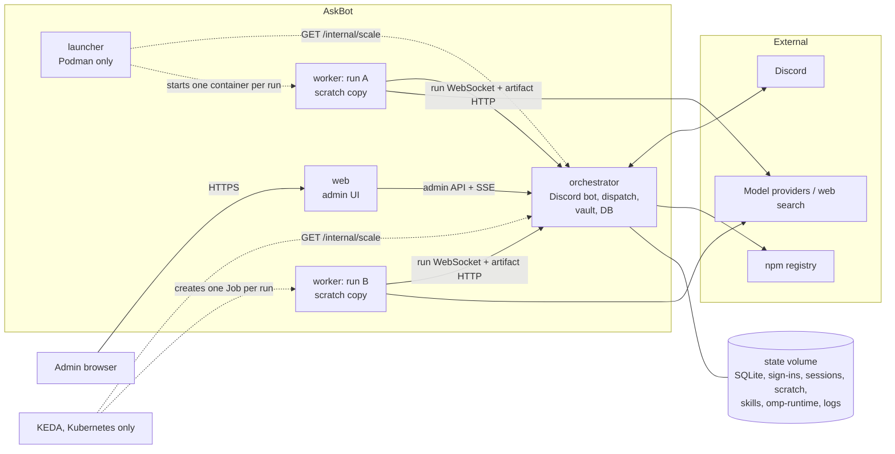
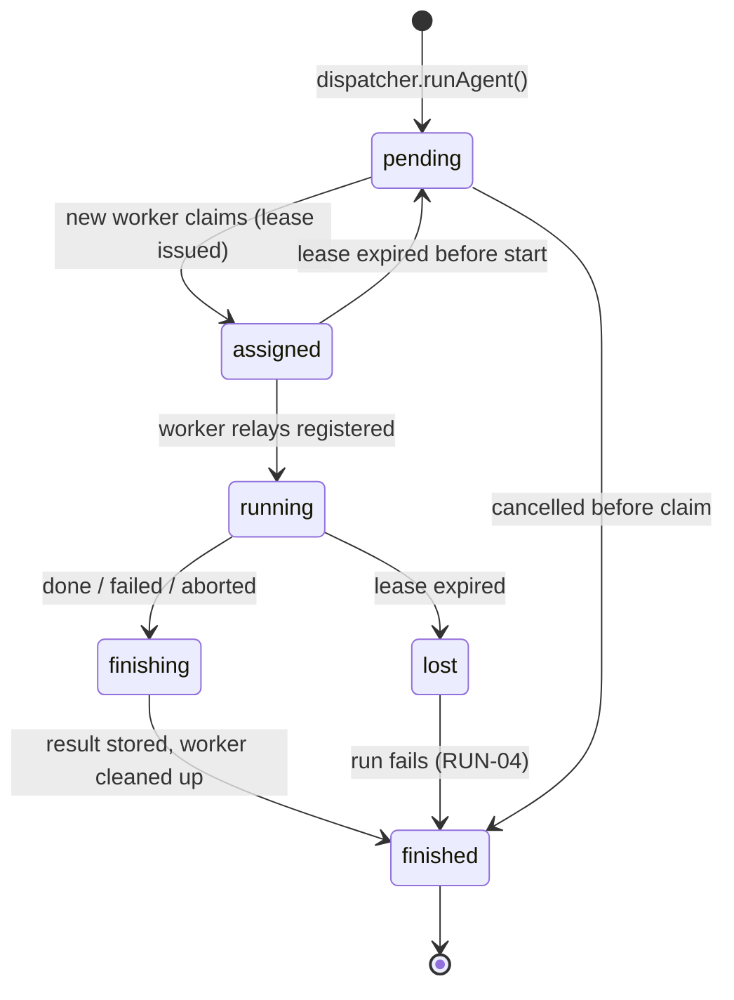
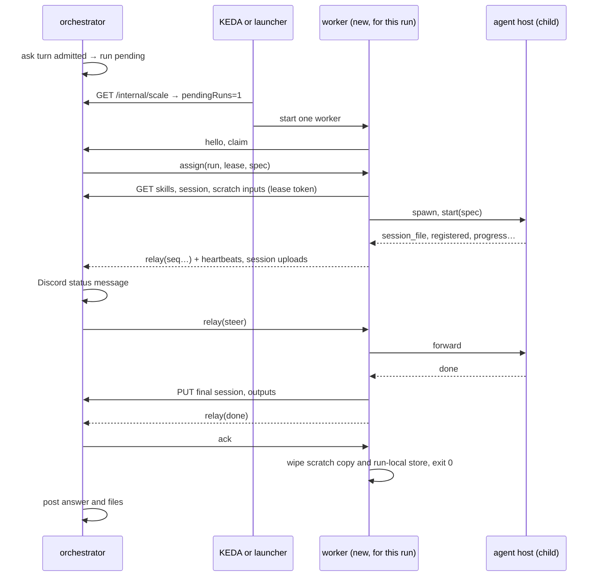

# Architecture

This document describes how AskBot is built and deployed. It builds on [requirements.md](requirements.md). AskBot is derived from AgentBot (`../AgentBot`, commit `1830870`); §10 lists which AgentBot requirement IDs were dropped, adapted or added.

AskBot keeps AgentBot's split into components (A-1), for the same reasons:
- the bot keeps running while the web UI restarts;
- **every agent run gets its own short-lived worker**, isolated from the orchestrator's credentials and from other runs;
- the worker is deleted when the run ends.

The difference is that a run has no checkout, only a scratch copy: the thread's attachments, the session and the admin's skills and agents.

## 1. Decisions

| # | Decision | Alternative rejected | Why |
|---|---|---|---|
| A-1 | Separate components: **web**, **orchestrator** (the chatbot), **worker** (one per agent run) and, on Podman, a **launcher** that starts the workers. | Keep one process. | The bot must be independent of the website and the omp processes, and each run must be isolated. |
| A-2 | The orchestrator is a **singleton** and the only owner of the database, the vault and all Discord credentials. | Several replicas with leader election. | Discord allows one gateway session per bot, and SQLite has one writer. Leader election would add a lot of moving parts for no throughput gain. |
| A-3 | **One worker per agent run, with no checkout.** The worker downloads the run's scratch inputs, the skills and agents, and the session to resume from the orchestrator. It returns the session and the new or changed outputs. Workers share no volume. | Run agent sessions inside the orchestrator; a shared volume for scratch files. | Public users steer the agent, so it must run away from the orchestrator's credentials. Runs cannot see each other's files, sessions or sign-ins. No RWX storage is needed. Cost: a worker start for every turn. |
| A-4 | Kubernetes starts workers with a **KEDA ScaledJob**, 0–10: one Job pod per agent run. | Orchestrator creates Jobs itself; a Deployment with a KEDA ScaledObject. | A Job finishes when its run finishes, so scale-down never kills a busy pod. The orchestrator needs no Kubernetes API permissions. Cost: KEDA must be installed. |
| A-5 | Workers **pull** their run from the orchestrator over a WebSocket. | The orchestrator pushes to worker endpoints. | Workers need no Service or published port, and the same worker code runs under the launcher and under KEDA. |
| A-6 | omp updates stay **in place, for workers only**. After approval on the web omp page (or automatically, with `omp.autoUpdate`) the orchestrator installs and packs a newer omp. Each new worker downloads it, falling back to the image's omp if it fails. | Image-only updates. | Users can take a new omp without rebuilding or redeploying. Running runs are not interrupted, and no component restarts. |
| A-7 | **One image** with four roles (`askbot orchestrator`, `askbot web`, `askbot worker`, `askbot launcher`). | Separate images. | One build, one version and shared layers. Workers need no extra toolchains, because the agent runs no code. |
| A-8 | **SQLite stays**, for both AskBot's database (`askbot.db`) and omp's model sign-in store, on a volume that only the orchestrator mounts (RWO). | Postgres; a separate credentials database. | There is a single writer (A-2), and omp already uses SQLite for sign-ins, so no new database is needed. |
| A-9 | **Model sign-ins stay in the orchestrator** (§6.1). Runs get a copy in the run spec, and token refreshes go through the orchestrator. | A shared sign-in store. | Keeps one refresh-token chain per provider. |
| A-10 | On Docker/Podman hosts, a **launcher** starts one worker container per run through a **rootless Podman** API socket. | A rootful Docker socket; long-lived pool workers. | Per-run containers need something that can start containers. A rootless socket limits that power to one unprivileged host user. Cost: per-run workers need Podman, not Docker Engine. |
| A-11 | **No configuration editor.** Settings, omp setting overrides, skills and agents are edited on web pages only (`/admin`, `/admin/omp`, `/admin/skills`). | AgentBot's VS Code (code-server) config workspace. | The editor was the largest part of AgentBot's web pod (code-server, its lock-down, sync and conflicts, a home volume). The pages already apply the same validation. |
| A-12 | **No GitHub and no git.** | Keep AgentBot's repository features, switched off. | AskBot is a Q&A bot, so the git endpoint, mirrors, bundles and code checkpoints are gone. A run that is lost is not requeued; it fails, and the user's next message resumes the session from its last upload. |

## 2. Components



| | web | orchestrator | worker | launcher (Podman) |
|---|---|---|---|---|
| Role | Admin UI | The chatbot and the system's brain | Runs exactly one omp session, then exits | Starts and removes worker containers |
| Replicas | 1 (login sessions are in memory) | exactly 1 | 0–10 in Kubernetes; 0–`ASKBOT_WORKER_CAPACITY` under the launcher | 1 |
| Holds credentials | none (only its internal API token) | Discord token, master key, vault, model sign-ins | its run's provider API keys and sign-in copy, in memory or run-local storage only | the scale token; passes the worker token to workers by secret name |
| Storage | none | state volume | ephemeral only (§5) | none |
| Ports | 8080 UI | 8081 internal API (never exposed) | none | none |

### 2.1 Orchestrator (the chatbot)

The orchestrator owns everything in requirements.md that is not the web UI or the agent session itself:
- the Discord bot: `/ask` and `/stop`, threads, progress messages, steering, and attachments in and out (scratch files live here and are copied to and from workers);
- the vault, settings, omp settings, and model-account sign-in and refresh (§6.1);
- the skills and agents directory, with the AGT-25 validation on upload (served to workers);
- listing the guild's channels with the bot's effective permissions for the Settings dropdown (requirements §5.4). Listing uses only the stored bot token over REST (no gateway connection) and works while the engine is `unconfigured`;
- usage accounting, agent transcripts, omp session files between runs;
- omp update checks and installs (§8);
- **run dispatch**: it turns ask turns into *runs*, hands each run to a fresh worker, relays its events, and enforces leases (§4).

It never runs an omp agent session itself. It still imports omp for settings validation, the settings reference and OAuth sign-in.

### 2.2 Web

The web component is a thin front end:
- It serves every page in requirements §5.3 and keeps login sessions and the login throttle in memory.
- It sets the security headers and checks the `Origin` header (WEB-05 to WEB-07, WEB-09).
- It reads and writes all data through the orchestrator's admin API, holding no database or vault of its own. Setup, login and unlock are forwarded to the orchestrator, which owns the vault. The setup token is printed in the **orchestrator's** log.
- It proxies the log stream (SSE) and log-file downloads from the orchestrator.
- It holds no model sign-ins, no omp and no volume.

When the orchestrator is unreachable, the web UI MUST still serve: login fails with "orchestrator unavailable", and the home page shows it.

### 2.3 Worker

A worker exists for exactly one run. It:
1. connects to the orchestrator and claims one run (within `ASKBOT_WORKER_CLAIM_TIMEOUT`, default 15 s; if nothing is left to claim, it exits 0, because another worker won the race);
2. downloads what the run needs: the skills and agents, the omp runtime copy if one applies (§8), the session file to resume, and the scratch inputs;
3. spawns the agent host as a **child process** (AGT-01 still holds inside the worker), with a run-private auth store seeded from the run spec (CRED-02). The host's `HOME` and `PI_CODING_AGENT_DIR` MUST point at writable run-local directories, set before omp is loaded; omp writes its logs, install id, auth store and an ~8 MB model cache (`models.db`) there (AgentBot spike S2, `../AgentBot/wiki/spikes/S2.md`);
4. relays the host's IPC to the orchestrator, and uploads the session file while it runs (RUN-18);
5. when the host ends, uploads the result: the session and the outputs (RUN-19);
6. wipes everything (RUN-20) and exits.

It has no Discord credentials and never talks to Discord.

### 2.4 Launcher (Docker/Podman only)

- **LCH-01** The launcher MUST start worker containers through a **rootless** Podman API socket mounted into it. At start it MUST check that the engine is rootless and refuse to run otherwise (exit 2): `GET /libpod/info` must return 200 with `host.security.rootless` set to `true`; any other response, including a Docker socket without `/libpod/` routes, counts as not rootless (AgentBot spike S6, `../AgentBot/wiki/spikes/S6.md`). `ASKBOT_LAUNCHER_ALLOW_ROOTFUL=1` overrides this for a rootful Podman socket only (200 with `rootless: false`) and logs a warning at every start, because a rootful socket gives the launcher root on the host. A Docker socket or an unreadable reply is refused even then.
- **LCH-02** Every 2 s it MUST read `pendingRuns` from `/internal/scale` (scale token). `pendingRuns` leaves out runs already claimed, so the launcher starts `max(0, min(pendingRuns − fresh, capacity − active))` workers, where `active` counts its labelled workers that have not exited and `fresh` those created within the claim timeout plus 10 s (they may not have claimed yet). It never runs more than `ASKBOT_WORKER_CAPACITY` (default 4) at once. Each worker container MUST be started:
  - from the stack's image (`ASKBOT_IMAGE`), with `--rm` and `init` (Podman's init as PID 1 reaps orphaned processes), on the workers network (`ASKBOT_WORKER_NETWORK`; in compose `<ASKBOT_NETWORK>-workers`, which only the orchestrator shares, §7.2), with no published ports, named and with hostname `askbot-worker-<8 hex>` so the orchestrator's worker id matches `podman ps`;
  - with the label `askbot.role=worker`;
  - with a memory limit (`ASKBOT_WORKER_MEMORY`, default 4 GiB) and swap set equal to it, so the worker has no swap; a CPU quota (`ASKBOT_WORKER_CPUS`, default 2, as `podman run --cpus`: quota per 100 ms period); and a limit of 4096 processes and threads (`pids_limit`);
  - hardened like the Helm worker: `no_new_privileges` (the base image's setuid binaries such as `su`, `mount` and `passwd` gain nothing) and every capability dropped (`cap_drop: ["all"]`). Workers keep the default rootless user-namespace mapping, shared by all workers, rather than `userns=auto` (a separate mapping per worker): auto needs about 10 000 subordinate ids per worker (the image's uid 10001), so the common 65 536-id `/etc/subuid` range would cap a host at 6 workers. With no capabilities and no privilege gain, reaching another worker's files needs a container escape; revisit with §11 item 2;
  - with the health check `askbot health` every 30 s, timeout 5 s, start period 30 s, 3 retries (requirements OBS-01);
  - with the worker token as the Podman secret `ASKBOT_WORKER_SECRET` (default `askbot_worker_token`) at `/run/secrets/worker_token`, and a 256 MiB tmpfs at `/run/askbot` (`nosuid,nodev`, mode 0700, owned by uid 10001 through the `U` mount option; not `noexec`, because omp may run tools it downloads to its agent dir) for run-local storage (§5; tmpfs pages count against the memory limit, AgentBot spike S6). The scratch copy lives in the container's own storage; its size is limited by the worker's measurement (STO-06), because rootless Podman cannot enforce a per-container disk limit;
  - with the command `askbot worker`.

  The launcher does not pull images: the image must already be on the host (compose pulls it for the services), or creates fail and are logged with the image name.
- **LCH-03** At start, and every minute after that, it MUST remove exited worker containers it started. It MUST NOT touch any container without its label.
- **LCH-04** It MUST hold no secret other than the scale token. It reports its health with `askbot health` (§4.5): after every tick that reached the Podman socket it rewrites a status file, and the probe exits 0 while the last socket contact is under 30 s old (an unreachable orchestrator alone does not make it unhealthy). `askbot health` checks the launcher when `ASKBOT_ROLE=launcher` is set or that file exists, and the worker otherwise.

## 3. Code layout (from AgentBot)

AskBot is ported from AgentBot's `src/` by copying modules and deleting what AskBot drops. The file-by-file keep and delete list is in [implementation.md](implementation.md) §2; this table is the summary.

| AgentBot path | AskBot component |
|---|---|
| `src/orchestrator/*` | orchestrator, without the repository, git, job, plan, draft, watch and question modules and without the Discord update notice |
| `src/worker/*`, `src/worker/host/*` | worker, without the checkout and without the tools AskBot does not expose (AGT-09) |
| `src/web/*` | web, without the Repositories page and the config editor |
| `src/shared/*` | shared, without the repository, workspace and git helpers |
| `src/launcher/*`, `src/cli.ts` | launcher and CLI, renamed |

## 4. Runs, dispatch and scaling

### 4.1 Run lifecycle

A *run* is one agent session: one ask turn. Each run gets its own worker. Runs are stored in the `runs` table:



- **RUN-01** A run becomes `pending` only when its caps allow it: `limits.maxChatSessions` and `workers.maxConcurrentRuns`. So `pending` is real demand.
- **RUN-02** A worker claims the oldest pending run. A claim is atomic and returns a **lease** (run id plus a random lease token). The lease token also authorises the run's artifact requests (§4.5). The worker MUST heartbeat every 10 s. A lease expires after 45 s without a heartbeat.
- **RUN-03** While a run is `pending` or `assigned`, its Discord progress line MUST read "Waiting for a worker…". This wait, including the worker's downloads, MUST NOT count toward the run's time limit.
- **RUN-04** When a worker is lost (lease expired while running), the run MUST fail with "the worker running this was lost (pod evicted or crashed)" and invite the user to send another message, which resumes the session from its last upload (RUN-18).
- **RUN-05** Abort and steering MUST be delivered through the run's worker connection. An abort with no connected worker MUST finish a `pending` run immediately. For an `assigned` or `running` run, the abort MUST be delivered when the worker reconnects, or the run is finished when its lease expires.

### 4.2 Run protocol

Each worker opens one WebSocket, `ws://orchestrator:8081/internal/worker`, authenticated with the worker token (§6). It carries JSON messages of two kinds:
- **control** messages between the worker and the orchestrator;
- **relay** messages, which carry the agent host's IPC messages unchanged, each wrapped with its run id and a sequence number per run and direction.

Bulk data (session files, scratch files, the omp runtime and skills) goes over plain HTTP endpoints authorised by the lease token (§4.5), not over the WebSocket.

**Control messages**

| Direction | Message | Content |
|---|---|---|
| worker → orch | `hello` | worker id (pod or container name), app identity (§7.1), image omp version, lease held (after a reconnect) |
| worker → orch | `claim` | asks for one run |
| orch → worker | `assign` | run id, lease token, kind `run`, **run spec** |
| worker → orch | `heartbeat` | lease token |
| worker → orch | `run-info` | omp version used for the run; sent when the host starts and again after a UPD-08 fallback |
| worker → orch | `omp-runtime-failed` | the host from the run's omp runtime copy exited before `registered` (UPD-08): copy id, version, exit code or signal, tail of the host's stderr |
| worker → orch | `session-upload` | a session file was uploaded (RUN-18) |
| worker → orch | `gone` | the host exited without `done` or `failed`: exit code, signal, OOM count (AGT-05) |
| worker → orch | `credential-request` | provider, the orchestrator's credential id of the sign-in that needs a refresh, and the worker's current access token (CRED-03) |
| orch → worker | `credential-response` | the access token and its expiry, or the refusal (CRED-05) |
| orch → worker | `scratch-input` | a follow-up's new attachment to download before the next steer (CHAT-08) |
| both | `ack` | per run and direction, the highest relay sequence number received and stored |

**Relay messages, agent host → orchestrator**, and what the orchestrator does with each:

| Message | Orchestrator |
|---|---|
| `progress` (tool, intent, usage, elapsed; at each turn end) | Edits the live status message: state, elapsed, cost, `↳ tool intent` (DSC-10, DSC-11). Stores the snapshot (RUN-14). |
| `session_file` | Records that the run's session exists, then sends the `reply` the host waits for. The file itself arrives by upload (RUN-18). |
| `registered` | Run becomes `running`. Steering and abort are delivered from now on (RUN-15). |
| `reply` | Answer to a relayed `steer` or `abort` (RUN-15). |
| `transcript`, `usage`, `loadout`, `log` | Agent log, usage accounting, status page, orchestrator log. Nothing goes to Discord. |
| `done`, `failed` | Sent by the worker only after the result is uploaded (RUN-19). The orchestrator finishes the status message (✅ or ❌), updates the top icon, then posts the answer and the produced files (CHAT-10). |

**Relay messages, orchestrator → agent host:** `steer`, `abort`, and `reply` (to `session_file`). The worker builds the host's `start` message from the run spec itself, so `start` is not relayed.

The **run spec** contains everything the worker needs:
- profile `ask`, prompt, output schema;
- time and cost limits, model, thinking level;
- whether a session file exists to resume;
- omp setting overrides and the content hash of the skills and agents bundle;
- provider API keys and a snapshot of the model sign-ins, with refresh tokens replaced by omp's `__remote__` placeholder (CRED-02);
- the list of scratch inputs;
- `ompRuntime`, when an omp runtime copy applies (§8).

The spec is sent only over the connection, never written to disk.



### 4.3 Reconnects and orchestrator restarts

- **RUN-06** A worker MUST keep its run going when the connection drops. It reconnects with backoff (1 s to 15 s) and re-announces its lease in `hello`. Relay messages MUST be sequenced and acknowledged in **both** directions; each side resends what the other has not acknowledged, and the receiver drops duplicates by sequence number. Buffering:
  - The worker buffers up to 10 000 messages or 16 MiB. When the buffer is full, it drops the oldest `progress`, `transcript` and `log` messages first. It never drops any other message.
  - The orchestrator stores its outgoing relay messages in the database until they are acknowledged, so a steer survives an orchestrator restart.
  - Uploads that fail while the orchestrator is away MUST be retried after the reconnect.
- **RUN-07** After a restart, the orchestrator MUST NOT fail `assigned` or `running` runs straight away. It MUST wait `workers.reattachGraceSeconds` (default 90) for their workers to re-announce, then treat the missing ones as lost (RUN-04).
- **RUN-09** Orchestrator shutdown (SIGTERM) MUST stop Discord and dispatch, flush the database and exit. It MUST NOT abort runs on workers.
- **RUN-14** For every run, the orchestrator MUST store, keyed by its ask thread so that a follow-up turn finds it before its new run exists:
  - the Discord ids of the thread and its live status message;
  - the latest progress snapshot (state, activity, elapsed, cost).

  After an orchestrator restart it MUST keep editing those same messages, re-rendered from the stored snapshot and from any replayed messages. It MUST NOT post new ones. If a message was deleted in Discord, it posts a new one and stores the new id.
- **RUN-15** A steer or an abort counts as delivered only when the run confirms it:
  - **Steering** gets 👀 when the host's `reply` for that steer comes back ok.
  - **While undeliverable** (worker disconnected, or host not yet `registered`), the orchestrator MUST react ⏳ and keep the message queued (RUN-06). It replaces ⏳ with 👀 on delivery.
  - **A steer refused** with "Agent session is not ready" MUST be resent after `registered`.
  - **If the run ends first**, the orchestrator MUST reply "Not delivered: the run ended before it could read this."
- **RUN-16** Workers MUST apply the OBS-03 field limits to `transcript` messages, and cut `log` lines at 8 KiB, before sending them. The orchestrator MUST reject any WebSocket message larger than 4 MiB and log the run and message type.

### 4.4 Scaling

Every run starts a new worker, in both runtimes, and every worker ends with its run.

**Docker / Podman.** The launcher (§2.4) starts one container per pending run, up to `ASKBOT_WORKER_CAPACITY` (default 4; the default `maxChatSessions` is 2). With nothing pending, no worker runs.

**Kubernetes.** A KEDA `ScaledJob`:

| Field | Value | Reason |
|---|---|---|
| trigger | `metrics-api` on `http://orchestrator:8081/internal/scale`, `valueLocation: pendingRuns`, `targetValue: "1"`, bearer token via `TriggerAuthentication` | one pod per pending run |
| `minReplicaCount` / `maxReplicaCount` | 0 / 10 (Helm `worker.maxReplicas`) | the requested range |
| `scalingStrategy.strategy` | `accurate` | `pendingRuns` excludes runs already claimed, which is the queue model `accurate` expects, together with `pendingPodConditions` |
| `scalingStrategy.pendingPodConditions` | `["Ready"]`, with a worker readiness probe that passes only once the worker has claimed a run | a started pod that has not claimed yet counts as pending, so slow worker start-up does not add pods (AgentBot spike S5, `../AgentBot/wiki/spikes/S5.md`) |
| `pollingInterval` | 5 s | short cold-start delay |
| Job `backoffLimit` | 0 | the orchestrator owns failure handling (RUN-04) |
| Job `restartPolicy` | `Never` | same reason |
| Job `ttlSecondsAfterFinished` | 60 | the pod and its `emptyDir` volumes are deleted a minute after the run (RUN-20) |
| Job `activeDeadlineSeconds` | unset | runs are bounded by the 20-minute turn limit (AGT-14) and the worker's own exit |
| Pod `terminationGracePeriodSeconds` | 60 | time for a final session upload on eviction (RUN-18) |

KEDA can start an extra pod for a run claimed between two polls (and, on KEDA < 2.19, near `maxReplicaCount`); that pod finds nothing to claim and exits 0 after the claim timeout. With `backoffLimit: 0`, a non-zero exit would leave failed Jobs behind. The worker's readiness MUST stay true from the claim until it exits.

- **RUN-10** The orchestrator MUST know the worker capacity from `ASKBOT_WORKER_CAPACITY`. Helm sets it to `worker.maxReplicas`, and compose sets it to the launcher's limit. The orchestrator MUST report the limits, capacity and warnings in its health responses (§4.5) and on the status page, together with pending runs and their age. A mismatch never blocks a settings save.
- **RUN-11** The concurrency actually reached is `min(maxChatSessions, workers.maxConcurrentRuns, worker capacity)`. To use 10 workers, raise `maxChatSessions`; the health warning says so while it is below the capacity.

### 4.5 Endpoints and health

| Endpoint | Component | Auth | Purpose |
|---|---|---|---|
| `GET /livez` | orchestrator | none | Liveness: 200 while the process responds. The body is the same as `/readyz`. |
| `GET /readyz` (alias `/healthz`) | orchestrator | none | Readiness: 200 whenever the database is open and the internal API can serve, **in every engine phase**, so that the web UI can always reach the admin API, even in `unconfigured` or `error`. 503 only when the database cannot be opened or the state volume is not writable. |
| `/internal/admin/*` | orchestrator | web token | Every web UI read and write, the log stream and log-file downloads, channel listing, sign-in, skills and agents, and omp updates (§8). |
| `/internal/worker` | orchestrator | worker token | Run protocol WebSocket (§4.2). |
| `/internal/runs/<id>/…` | orchestrator | that run's lease token | Run artifacts: `GET` session, scratch inputs, skills bundle and omp runtime; `PUT` session and scratch outputs (RUN-18, RUN-19). One upload at a time per run and artifact (503 with `Retry-After`, which the worker retries); the session is capped at 256 MiB, scratch outputs per CHAT-10; uploads are refused with 507 while the state volume has under 1 GiB free. An upload is kept only if the run still holds its lease when it completes. |
| `GET /internal/scale` | orchestrator | scale token | `{pendingRuns}` for KEDA and the launcher. |
| `GET /healthz` | web | none | 200 while the web UI serves, whatever the orchestrator's state (requirements §5.3). Relays the orchestrator's `phase` and `limits`. |
| `askbot health` (command) | worker, launcher | — | Worker: prints `{status, version, phase, runId, connected}`, where phase is `claiming`, `preparing`, `running`, `uploading` or `cleanup`. Launcher: prints `{status, version, rootless, workers, capacity}`. Exits 0 while the process is alive. Used by the container `HEALTHCHECK` (output kept in `podman inspect`) and as the Kubernetes exec liveness probe. `askbot health --claimed` (worker) exits 0 only once the worker has claimed a run; it is the Kubernetes readiness probe (§4.4). |

The orchestrator's health body reports its limits:

```json
{
  "status": "ok",
  "version": "0.1.0",
  "phase": "running",
  "runs": { "pending": 1, "running": 2 },
  "limits": {
    "maxChatSessions": 2,
    "maxConcurrentRuns": 10,
    "workerCapacity": 10,
    "effectiveConcurrency": 2
  },
  "warnings": [
    "maxChatSessions (2) is below worker capacity (10): at most 2 workers will be used"
  ]
}
```

- **RUN-12** `limits` MUST be `null` while the settings are locked or not yet saved. Warnings MUST be raised when `maxChatSessions` is below the worker capacity, and when `workers.maxConcurrentRuns` exceeds the worker capacity (runs may wait with no worker coming). The status code MUST NOT depend on limits or warnings.
- **RUN-13** Health bodies are unauthenticated, so they MUST contain only the version, phase, counts, limits and fixed warning texts. They MUST NOT contain names, ids, error messages or any other data.

### 4.6 Sessions, outputs and cleanup

- **RUN-18** **Session uploads.** The worker MUST upload the run's session file:
  - when the host first reports `session_file`;
  - every 5 minutes;
  - when it receives SIGTERM (eviction, shutdown). omp's SDK handles SIGTERM for the whole worker process and gives registered cleanups 10 s before it exits, so this upload is bounded by that; the 5-minute upload stands when it does not finish;
  - before the result.

  Each upload replaces the thread's stored session, and is announced with `session-upload`.
- **RUN-19** **Result.** When the host ends, the worker MUST do the following before it relays `done` or `failed`:
  1. upload the final session file;
  2. upload the new or changed regular files in `outputs/` (symlinks excluded).

  The orchestrator stores the outputs in the thread's scratch directory, so they are posted with the answer (CHAT-10) and stay available to the next turn.
- **RUN-20** **Cleanup.** Whatever the outcome, once the orchestrator acknowledges `done` or `failed`, the worker MUST:
  1. delete its scratch copy, session copy, skills copy and run-local auth store;
  2. exit 0.

  The container (`--rm`, launcher) or Job pod (`ttlSecondsAfterFinished`) is then deleted. Session files stay in the orchestrator (requirements ENG-05).
- **RUN-21** **One run per thread.** At most one run per ask thread MUST be pending or active at a time.

## 5. Storage

| Volume | Mounted by | Docker/Podman | Kubernetes | Contents |
|---|---|---|---|---|
| state | orchestrator | `askbot-state` | PVC, RWO | `askbot.db` (SQLite, WAL with `synchronous=NORMAL`: commits do not wait for an fsync, which stalled AgentBot's orchestrator on a busy node; see `../AgentBot/wiki/load-test.md`); `omp-agent/` (omp sign-in store `agent.db`, model cache); `sessions/`; `scratch/` (ask inputs and outputs); `omp/` (skills and agents); `omp-runtime/` (packed omp copies); `logs/agent/`, `logs/orchestrator/` |
| worker scratch | one worker | container storage, size measured by the worker (STO-06) | `emptyDir`, `sizeLimit` (`worker.diskLimit`, default 2 Gi) as a backstop | at `/tmp/askbot-worker/<pid>/` (`$TMPDIR/askbot-worker`): the run's scratch copy, session copy, skills copy, and the unpacked omp runtime copy when one applies (§8; about 1 GB, not counted against the STO-06 limit) |
| run-local | one worker | tmpfs (`U` for ownership) | `emptyDir`, `medium: Memory` | at `ASKBOT_WORKER_RUN_DIR` (image: `/run/askbot`), one `<pid>/` per worker process: the status file read by `askbot health`, run-private auth store, omp's `HOME` and agent dir (logs, install id, ~8 MB model cache, AgentBot spike S2), and the agent host's `TMPDIR`. It counts against the memory limit. |

- **STO-01** SQLite databases (`askbot.db` and omp's `agent.db`) MUST live only on the state volume. No other component may open them.
- **STO-02** Every container MUST run as uid/gid 10001. In Kubernetes, `fsGroup: 10001` and `runAsNonRoot: true` MUST be set, so nothing has to re-own files at start.
- **STO-04** At most one run MUST use a given ask thread at a time (RUN-21).
- **STO-06** A worker's scratch space MUST be limited by `ASKBOT_WORKER_DISK` (default 2 GiB). The worker MUST measure its scratch copy's size every few seconds and fail the run with "the run ran out of disk space" when it passes the limit, which is reported like an OOM: the agent is told, and the run is flagged. Under Podman this is a soft limit, because a rootless engine cannot enforce a per-container disk limit (AgentBot spike S6); the host disk is the hard ceiling. Under Kubernetes, `emptyDir.sizeLimit` is also enforced, by the kubelet's periodic measurement.

## 6. Security

| Secret | Lives in | Seen by |
|---|---|---|
| Discord bot token, provider API keys | vault (state volume) | orchestrator. Provider keys are also sent per run to that run's worker, in memory. |
| Master key | secret file (compose, §7.2) / Kubernetes Secret, file mount | orchestrator only |
| `web-api-token` | secret | web, orchestrator |
| `worker-token` | secret | workers, orchestrator |
| `scale-token` | secret | launcher, KEDA `TriggerAuthentication`, orchestrator |
| Lease token | issued per run at claim | that run's worker; valid only for that run's artifact endpoints, until the run finishes |
| Model sign-ins (OAuth) | `<state>/omp-agent/agent.db` | orchestrator. A per-run copy without refresh tokens goes to the worker (CRED-02). |

- **SEC-14** Each token MUST be accepted only on its own API surface:
  - the web token on `/internal/admin/*`;
  - the worker token on `/internal/worker`;
  - the scale token on `/internal/scale`;
  - a lease token only on its own run's `/internal/runs/<id>/*`.

  Tokens MUST be compared in constant time.
- **SEC-15** The orchestrator's port 8081 MUST NOT be published outside the stack: no host port in compose, and a ClusterIP Service in Kubernetes. Kubernetes NetworkPolicies MUST restrict **ingress**:
  - to orchestrator:8081, only from web and worker pods and KEDA;
  - to web:8080, only from the ingress controller;
  - to workers, nothing;
  - worker → web is denied.

  **Egress.** The orchestrator's stays open: it needs Discord, npm and the model providers' sign-in endpoints. Kubernetes NetworkPolicies MUST restrict the rest:
  - web: only DNS and orchestrator:8081.
  - workers: DNS, orchestrator:8081, and every other address except link-local (`169.254.0.0/16`, `fd00:ec2::254/128`: the cloud metadata services, which hand out node credentials) and the cluster's pod and Service ranges (`networkPolicy.worker.clusterCIDRs`, by default every private range: `10.0.0.0/8`, `172.16.0.0/12`, `192.168.0.0/16`, `100.64.0.0/10`, `fc00::/7`). Workers need model providers and web search (with no search keys configured, omp's keyless default, `search.parallel.ai`, AgentBot spike S2).
  - DNS means port 53 at the peers in `networkPolicy.dns` (default kube-dns/CoreDNS in `kube-system`; NodeLocal DNSCache's link-local address must be added there).
  - Enforcement is the CNI's: many (kindnet among them) do not filter traffic from a pod to its own node, so host-network services on that node, such as the API server of a one-node cluster, stay reachable.

  On Podman, workers run on their own network, `<ASKBOT_NETWORK>-workers`, which only the orchestrator shares; web and the launcher are not on it, so a worker resolves neither name. Strict isolation (no traffic to or from any other bridge network) keeps it from web's address too: Podman ≥ 6 isolates every network so by default, and compose sets `isolate: strict`, which older Podman applies under podman-compose only (Podman's Docker API, used by docker-compose, drops the option). Remaining paths, accepted:
  - **web's published port.** Podman forwards a published port from the host address `host.containers.internal`/`169.254.1.2` and from every network's gateway, across isolated networks (netavark ≥ 2.1), so a worker still reaches the web UI on `<gateway>:<ASKBOT_WEB_HOST_PORT>` (measured in AgentBot on Podman 6.1.4). Through `169.254.1.2` the published service sees the same client address as a browser on the host, so a worker can spend the admin's login attempts (WEB-03) and lock the admin out for 15 minutes at a time; the password itself stays protected by the throttle. Closing this needs host-side filtering or a front end that is not a published container port.
  - **Other egress.** The internet, the host's own networks and, on a cloud VM, its metadata service (rootless traffic leaves through the host's network stack), so such a VM must not carry an instance role the agents may not hold.

  Only the web service publishes ports.
- **SEC-16** The master key is mounted as a file readable only by uid 10001 in the orchestrator, where no agent ever runs.

**Isolation and accepted risks.**
- **What a run can't reach:** an agent sees only its own worker. It cannot read other runs' sessions, scratch files or sign-in copies through its own lease.
- **What code in a worker can reach:** its worker's token, its own lease token and sign-in copy, and the internet.
- **The remaining risk:** with the worker token, code in a worker can open a second worker connection under a new worker id and claim a pending run. A claimed run hands over its prompt, its scratch inputs, its session, the provider keys and sign-in copy (CRED-02), and its answer is posted to Discord. There is no repository access. Mitigations:
  - the worker token grants only the run protocol;
  - a lease token works only for its own run;
  - a worker that has claimed a run MUST NOT be able to claim a second one on any connection made from it. The orchestrator enforces this per worker id and per network address: a worker id is bound to the address it first said hello from (a `hello` for it from any other address is refused), and an address holds one claim at a time. A claim is refused while another connection from the same address holds a run, or while a run claimed from that address is unfinished or finished less than 60 s ago. The address is stored with the run (`runs.worker_address`), so the rule survives an orchestrator restart. `ASKBOT_WORKER_ADDRESS_BINDING=off` turns the address rules off, for service meshes that rewrite source addresses; one claim per worker id then remains, which code in the worker defeats with a new id;
  - the status page lists every connected worker (id, pod or container, address), so an unknown one stands out.

  The address rule stops a second claim from the same pod or container. It does not stop code that reaches the orchestrator from another address. Running the agent host as a different user from the worker supervisor, in a second container without the worker token, closes this gap (§11 item 2).

**Public users and the agent's tools.** Public users steer the agent. The `ask` profile's confined tools (AGT-09, AGT-28, AGT-30) and the subagent allowlist (AGT-31) are what keep them away from the worker token on disk and in `/proc`. Because there is no shell, a public user can't run code in the worker except through bugs in the confined tools; a security review of those tools is part of the release (implementation.md, phase 9).

### 6.1 Model sign-ins

- **CRED-01** Model sign-ins MUST be stored only in the orchestrator, in omp's own SQLite store at `<state>/omp-agent/agent.db` on the state volume. Workers and web MUST NOT mount it.
- **CRED-02** Before dispatching a run, the orchestrator MUST refresh any sign-in that expires within 10 minutes. It then puts a snapshot of all sign-ins into the run spec, with refresh tokens replaced by omp's `__remote__` placeholder (omp's `credentials.snapshot()`); refresh tokens never leave the orchestrator. The worker MUST write the snapshot to a run-private auth store on run-local storage (§5), mode 0700, and delete it when the run ends.
- **CRED-03** Workers MUST NOT refresh tokens with the provider themselves. The worker's run-private store MUST install omp's `AuthStorageOptions.refreshOAuthCredential` hook (`discoverAuthStorage(agentDir, { authStorageOptions: { refreshOAuthCredential } })`), which sends `credential-request`. Every session MUST be given that `authStorage` and its `modelRegistry`, because omp code paths that are not given a store open their own without the hook. The orchestrator refreshes once per sign-in at a time and MUST answer within omp's 10 s refresh deadline:
  - if the sign-in no longer exists, it refuses (CRED-05);
  - if its stored access token differs from the worker's and is still fresh, it returns the stored token;
  - if the worker sends the stored token while it is still fresh (the provider rejected it), it refreshes at most once a minute per sign-in, and otherwise answers with the stored token, so a hijacked run connection can't churn the refresh-token chain;
  - otherwise it refreshes, stores the result and answers every waiting request with it. A refresh that misses the deadline keeps going; requests meanwhile join it.

  This keeps one refresh-token chain per sign-in: for providers that rotate refresh tokens, a refresh in one run would otherwise invalidate the orchestrator's copy and every other run's. AgentBot spike S1 confirmed the hook (`../AgentBot/wiki/spikes/S1.md`).
- **CRED-05** Signing out in `/admin/models` MUST remove the sign-in from the orchestrator at once. Runs that already hold a copy keep it until they end, but their refresh requests for that sign-in MUST be refused.

## 7. Deployment

### 7.1 Image

There is one image, `ghcr.io/<owner>/askbot:<version>`, and the role is its command argument. It contains Bun, the app, omp (npm's latest at build time with the pin as fallback, UPD-01) and procps. It contains no git and no code-server.

The `Dockerfile` at the repository root builds it (`podman build -t askbot:dev .`, rootless). `ENTRYPOINT ["askbot"]` (`/usr/local/bin/askbot`, which runs `bun /app/src/cli.ts`), no default command. Build args: `ASKBOT_OMP` (`latest`, the default; `pin`, which CI uses to test the pinned version; or an exact version to try instead of npm's latest), `ASKBOT_VERSION`, `ASKBOT_COMMIT`, `ASKBOT_BUILD_DATE`. `scripts/omp-latest.ts` does the UPD-01 install and logs one `omp version chosen` line with the installed version and the reason. The image sets `ASKBOT_STATE_DIR=/state`, `ASKBOT_OMP_RUNTIME_DIR=/state/omp-runtime`, `ASKBOT_WORKER_RUN_DIR=/run/askbot`, both listeners on `0.0.0.0` (web 8080, internal 8081); `/state` and `/run/askbot` are owned by 10001, so a named volume mounted there inherits the ownership.

The image carries an **app identity**: a file `/app/IDENTITY` holding the AskBot version and a hash of the app sources and lockfile. The omp-runtime checks in §8 compare app identities, not container image ids or digests.

| Role | Entrypoint duties |
|---|---|
| orchestrator | Open the state volume. Run `askbot orchestrator`. |
| web | `askbot web`: the web server only. |
| worker | `askbot worker`: one run, then exit. |
| launcher | `askbot launcher` (Podman only). |

No entrypoint runs as root.

### 7.2 Podman (compose)

`compose.yaml` defines three long-running services, `orchestrator`, `web` and `launcher`, run with `podman compose` under **rootless Podman ≥ 4.6**. The launcher starts the worker containers. Docker Engine can run the three services but cannot run workers: the launcher refuses a rootful socket (LCH-01).
- **Networks.** All three services are on the stack network (`ASKBOT_NETWORK`, default `askbot`). Workers are on their own network, `<ASKBOT_NETWORK>-workers` (the launcher's `ASKBOT_WORKER_NETWORK`), with strict isolation; the orchestrator is on both, web and the launcher only on the stack network (SEC-15). Both have fixed names because the launcher attaches workers by name.
- **Podman socket.** The host user enables it once with `systemctl --user enable --now podman.socket`. Compose mounts `$XDG_RUNTIME_DIR/podman/podman.sock` (or `ASKBOT_HOST_PODMAN_SOCKET`, where the client's `XDG_RUNTIME_DIR` is not the Podman host's, as on a podman machine) into the launcher only. The launcher runs with `--security-opt label=disable` (SELinux blocks a confined container from the user's socket) and `--userns=keep-id:uid=10001,gid=10001` (so uid 10001 owns the socket inside the container); without both it cannot connect (AgentBot spike S6, tested on Fedora CoreOS 44 with Podman 6.1.4 only).
- **User namespace.** All three services run with `userns_mode: keep-id:uid=10001,gid=10001`, so the host user is askbot (10001) inside them: the secret files below keep their owner and mode 0400. Workers use the default rootless mapping (not `userns=auto`, LCH-02).
- **Volume.** One named volume, `askbot-state`, mounted only into the orchestrator.
- **Restarts.** `restart: unless-stopped` on all three.
- **Health checks.** Every 30 s, timeout 5 s, start period 30 s, 3 retries (requirements OBS-01), also for workers (LCH-02):
  - orchestrator: `GET :8081/healthz` (= `/readyz`, §4.5);
  - web: `GET :8080/healthz`;
  - launcher and workers: `askbot health`.
- **Ports.** Only web publishes a port: `127.0.0.1:8080` (UI).
- **Secrets.** Created once by `scripts/init-secrets.sh`: `askbot_master_key`, `askbot_web_api_token`, `askbot_worker_token`, `askbot_scale_token`, as files (mode 0400, labelled `container_file_t` on SELinux hosts) in a secrets directory (`ASKBOT_SECRETS_DIR`, default `secrets/` next to `compose.yaml`). Compose mounts each as a `file:` secret only into the services that need it: the master key and the worker token into the orchestrator only, the web token into orchestrator and web, the scale token into orchestrator and launcher. They are not `external: true` Podman secrets because docker-compose, one of the two providers `podman compose` runs, refuses external secrets outside Swarm ("unsupported external secret"). The worker token is also stored as the Podman secret `askbot_worker_token` (`ASKBOT_WORKER_SECRET`) with the same value: the launcher passes it to workers by name and never mounts it (LCH-04).
- **Capacity.** `ASKBOT_WORKER_CAPACITY` (default 4) is set on both the launcher and the orchestrator.
- **Start order.** `depends_on: orchestrator` with `condition: service_started`. The web UI and launcher retry their connection, so the order is a convenience.
- **Upgrade.** `podman compose pull && podman compose up -d`. Workers already running keep their image and finish their run; new workers use the new image. Runs continue across an orchestrator restart (RUN-06, RUN-07).
- **Boot.** Starting the stack at boot belongs to the host's own setup, not this repository: for example a systemd user unit running `podman compose up -d` (with `podman compose stop`, not `down`, at shutdown, because `down` removes the network running workers are attached to), with linger enabled for the stack user.

### 7.3 Kubernetes

A Helm chart, `deploy/helm/askbot`:

| Object | Notes |
|---|---|
| Deployment `orchestrator` | `replicas: 1`, `strategy: Recreate` (never two gateways or two SQLite writers). Readiness `/readyz` and liveness `/livez` (§4.5): both succeed in every engine phase, so the web UI can reach the admin API while the engine is `unconfigured` or in `error`, and a configuration error does not crash-loop. Env `ASKBOT_WORKER_CAPACITY` = `worker.maxReplicas`. |
| Service `orchestrator` | ClusterIP, port 8081 |
| Deployment `web` | `replicas: 1` (login sessions are in memory, §11 item 1). No volume. Readiness and liveness on `/healthz`, which never fails because of the orchestrator. |
| Service `web` (+ optional Ingress) | port 8080. The Ingress terminates TLS so the session cookie is `Secure` (WEB-05). |
| ScaledJob `worker` + TriggerAuthentication | §4.4. Exec liveness probe `askbot health`; exec readiness probe `askbot health --claimed` (run claimed), `periodSeconds: 1`, `failureThreshold: 1`. `successfulJobsHistoryLimit` stays at its default, so `ttlSecondsAfterFinished` decides when Jobs are deleted. `emptyDir` for the scratch copy at `/tmp` (`sizeLimit` = `worker.diskLimit`, default 2Gi, also passed as `ASKBOT_WORKER_DISK`) and a memory-backed `emptyDir` at `/run/askbot` for run-local storage. |
| PVC | `state` (RWO), the only one. No RWX storage. It carries `helm.sh/resource-policy: keep`, so `helm uninstall` does not delete the vault. |
| Secrets | master key and the three tokens, generated by the chart on first install and kept on upgrade (`lookup`), also with `helm.sh/resource-policy: keep` (the vault can't be opened without the master key). Can be supplied instead (`existingSecret`). Mounted as files `root:10001` mode 0440: Kubernetes cannot set a secret file's owner, so group read is how only askbot reads them. |
| NetworkPolicies | SEC-15: ingress for every pod, egress for web and workers. The KEDA and ingress-controller selectors, the DNS peers (`networkPolicy.dns`) and the ranges workers may not reach (`networkPolicy.worker.clusterCIDRs`) are values; `networkPolicy.web.allowAll` opens web for clusters without an ingress controller. |
| Every pod | `runAsUser/runAsGroup/fsGroup 10001`, `runAsNonRoot`, no privilege escalation, all capabilities dropped, `automountServiceAccountToken: false`, `shareProcessNamespace: true` (the pause container reaps orphaned processes, like compose's `init`), and `enableServiceLinks: false` (otherwise Kubernetes injects `ASKBOT_WEB_PORT=tcp://…` for the `askbot-web` Service, which collides with AskBot's own variable). |

The chart requires Kubernetes ≥ 1.27 (`kubeVersion`), and its install and upgrade fail with a clear message when the `keda.sh/v1alpha1` `ScaledJob` API is missing (`keda.skipCrdCheck` skips the check for offline `helm template`).

Default resources (values):

| Component | Requests | Limits |
|---|---|---|
| orchestrator | 250m CPU, 512 Mi | 1 Gi |
| web | 100m CPU, 128 Mi | 512 Mi |
| worker | 250m CPU, 512 Mi, 2 Gi ephemeral storage | 4 Gi |

Requirements: Kubernetes ≥ 1.27 and KEDA ≥ 2.12; KEDA ≥ 2.19 is recommended (AgentBot spike S5).

## 8. omp updates (in place, workers only)

- **UPD-06** The orchestrator checks npm (UPD-02) and shows the result on `/admin/omp` (WEB-33). On approval, or automatically (`omp.autoUpdate`), it MUST:
  1. install the new omp into `<state>/omp-runtime/<version>-<time>/` (`bun install --omit=dev`, pinned packages);
  2. smoke-load the **worker** entry modules (`src/worker/main.ts`, `src/worker/host/session.ts`, `src/worker/host/serve.ts`);
  3. check the installed version;
  4. pack the copy as one compressed archive and record its app identity and hash;
  5. mark it active.

  No component restarts. Failures are reported as in UPD-03.
- **UPD-07** At start, a worker MUST download and unpack the active copy when its recorded app identity (§7.1) equals the worker's own and the copy is not marked failed. Otherwise it uses the image's omp. The version actually used MUST be sent in `run-info` (again after a UPD-08 fallback) and recorded on the run.
- **UPD-08** The first run on a new copy is the canary. If the host from the copy exits before it relays `registered`, the worker MUST:
  1. report it, so the orchestrator marks the copy failed and `/admin/omp` shows the failure with a fresh **Approve update** button;
  2. start the same run again with the image's omp.

  Only one fallback per run is allowed.
- **UPD-09** At start, the orchestrator MUST mark for deletion copies whose app identity differs from its own (a new image was deployed), and every copy except the active one. It MUST delete a marked copy only once no `assigned` run is still downloading it.
- **UPD-10** The orchestrator keeps the image's omp. It uses it for settings validation, the settings reference and sign-in. The web pod has no omp. The omp page MUST show both versions when they differ.

How it is built (`src/orchestrator/omp/`, `src/shared/ompRuntime.ts`, worker `runner.ts`):

- **Copy layout.** `<state>/omp-runtime/` holds `active` (the active copy's id, replaced atomically; absent means workers use the image's omp) and one directory per copy, `<version>-<base-36 ms>/`: `app/` while it is made (the image's `src/`, `package.json` and `bun.lock`, the omp packages pinned to `<version>`, `bun install --omit=dev` with its cache inside the tree; deleted once packed), `runtime.tar.gz`, `copy.json` (id, version, app identity from `/app/IDENTITY`, sha256, size, time, approver; a directory without it is an unfinished install) and `FAILED` (the canary failure). The smoke load imports `src/worker/main.ts`, `src/worker/host/session.ts` and `src/worker/host/serve.ts` from the tree.
- **Archive.** A gzipped tar made with the system `tar` of `src/`, `package.json`, `bun.lock` and `node_modules/`, streamed from disk (a copy is far too large to hold in memory). Measured in AgentBot's image (pin 18.12.1, copy 18.14.0): 269 MB packed, 950 MB unpacked; installing and packing took 29 s, unpacking 5 s, and the host from the copy registered 2 s after its start.
- **Run spec and download.** The spec carries `ompRuntime` (copy id, version, identity, sha256, size) when an active copy exists and is not failed. `GET /internal/runs/<id>/omp-runtime` streams the archive of the copy that run was given. The worker downloads it into its worker root (container storage, not the run-local tmpfs), checks the hash, unpacks it into `<root>/omp-runtime/`, checks the omp version, and spawns the host from `<root>/omp-runtime/src/worker/host/host.ts`. A copy with another identity, a missing archive, a hash or version mismatch, or a failed unpack is logged and the image's omp is used, without a failure report.
- **Canary.** The host from a copy runs with its stderr piped (and passed through) so the worker can report its tail in `omp-runtime-failed`. The fallback is skipped when the run was stopped, aborted or over its disk limit. The orchestrator takes the first report for a copy: it writes `FAILED`, clears `active`, marks the copy for deletion, and records the attempt as failed, which `/admin/omp` shows with a fresh **Approve update** button.
- **Approval on the web.** `POST /internal/admin/omp/update-check` runs a check now (**Check now**). `POST /internal/admin/omp/update-approve {version}` claims the install before anything is awaited, records the logged-in admin's username, and starts it; it answers 409 when `version` is no longer on offer (stale) or an install is already running. `GET /internal/admin/omp` returns `latest`, `checkedAt`, `checkError`, `attempt` and `autoUpdate`, which `/admin/omp` renders (WEB-33). With `omp.autoUpdate` on, after each check the orchestrator reads the state and calls `install(version, "auto-update")` in one synchronous step, so a concurrent approval is refused, unless the last attempt for that version failed (UPD-03). Outside the image, approval is refused (UPD-05).
- **Deletion (UPD-09).** Marked copies (at start; the previous copy on activation; a failed copy) are deleted when no `assigned` run was given that copy; a run assigned before this orchestrator started may have been given any copy. Marked copies are looked at every 5 s.
- **State.** `kv` keys `omp.update.latest`, `.checkedAt`, `.checkError` and `.attempt` (the last approval: version, from, by (admin username or `auto-update`), outcome `installing`, `installed` or `failed`, error, output tail, copy). An attempt still `installing` at start is recorded as failed.

## 9. Failure behaviour

| Failure | Effect |
|---|---|
| Orchestrator restart or crash | Discord pauses. Runs keep going on their workers and re-attach within 90 s (RUN-06, RUN-07). Uploads are retried. The web UI shows "orchestrator unavailable". |
| Web restart | Admins are logged out (in-memory sessions). No effect on Discord or runs. |
| Worker container or pod lost | Lease expiry after 45 s, then RUN-04: the ask run fails, and the user's next message resumes the session from its last upload. |
| KEDA or the launcher missing or not starting workers | Runs stay pending. Discord shows "Waiting for a worker…" and the status page shows pending runs and their age. |
| Launcher pointed at a rootful socket | The launcher refuses to start (LCH-01). Runs stay pending. |
| OOM or full disk in a worker | AGT-17 to AGT-19 and STO-06. Each worker has its own limits, so it is reported for that run only. |

## 10. Derivation from AgentBot

AskBot's requirement IDs follow AgentBot's at commit `1830870` (requirements.md, ID policy). Every kept ID also takes the AskBot renames: `AgentBot` → `AskBot`, `agentbot` → `askbot`, `AGENTBOT_*` → `ASKBOT_*`, `agentbot_session` → `askbot_session`, `agentbot.db` → `askbot.db`, and the image, chart, worker-name, label and secret names to match.

| Kind | IDs | Reason |
|---|---|---|
| Dropped | GH-01 to GH-27, ISS-01 to ISS-06, JOB-01 to JOB-23, CI-01 to CI-09, PR-01 to PR-03, WS-01 to WS-08; AGT-10, AGT-16, AGT-21, AGT-22; DSC-05, DSC-09, DSC-12, DSC-13, DSC-16 to DSC-23, DSC-25 to DSC-28, DSC-33 to DSC-38; CHAT-01, CHAT-02; WEB-08, WEB-12 to WEB-19, WEB-25 to WEB-32; SEC-06 to SEC-11; OPS-05; RUN-08, RUN-17; STO-03, STO-05; CRED-04 | GitHub, issues, jobs, the CI gate, PRs, git and checkouts (A-12); `create_issue`; the to-do list (`update_todos` and the Discord to-do message); MCP; agent questions; `/work`, the work channel and watch channels; repo chat; the VS Code config editor (A-11). WEB-12, WEB-13, WEB-15 to WEB-19, SEC-07 to SEC-11, STO-05, CRED-04 and OPS-05 were already withdrawn in AgentBot. |
| Adapted | AGT-01, AGT-02, AGT-06, AGT-08, AGT-09, AGT-11 to AGT-14, AGT-18 to AGT-20, AGT-23, AGT-25, AGT-27; DSC-01 to DSC-04, DSC-07, DSC-10, DSC-15, DSC-29 to DSC-32; CHAT-03, CHAT-04, CHAT-06, CHAT-07; WEB-03, WEB-05 to WEB-07, WEB-20 to WEB-24; OBS-01 to OBS-03, OBS-05, OBS-06; SEC-01, SEC-02, SEC-05, SEC-13 to SEC-16; ENG-02 to ENG-05; DB-01 to DB-03; UPD-02, UPD-03, UPD-05, UPD-06, UPD-08, UPD-10; OPS-01 to OPS-03, OPS-06, OPS-07; NFR-01 to NFR-06; RUN-01 to RUN-07, RUN-09, RUN-11, RUN-12, RUN-14, RUN-15, RUN-18 to RUN-21; STO-01, STO-04, STO-06; LCH-02 | One `ask` profile with web search and file processing; skills and task agents in `/ask`; `/stop` instead of `/work cancel`; omp updates approved on the web; a run has a scratch copy instead of a checkout; no web volume. |
| New | AGT-30 to AGT-32, DSC-39, WEB-33 | Skills and task agents in `/ask`; `/stop`; the omp update panel. |

All other IDs are kept with only the renames.

## 11. Open items

1. **Web replicas** (AgentBot §11 item 3). More than one web replica needs sessions stored in the orchestrator. Not needed at one admin.
2. **Agent and supervisor in separate containers** (AgentBot §11 item 6): the first change after release. Run the agent host in a second container, as a different user and without the worker token, with the lease kept in the supervisor's container under its own uid, so the agent can't read the lease token from `/proc` either. This closes the remaining claim risk in §6. It touches the worker runtime, the IPC transport, the launcher spec, the Helm Job and the shared scratch volume. What stays after it: an agent can still read its own run's keys and sign-ins.
3. **Size of the packed omp copy** (AgentBot §11 item 7). Each worker downloads it when an in-place update is active (UPD-07): 269 MB packed, 950 MB unpacked for omp 18.14.0 (§8). With `worker.diskLimit` at its 2 Gi default, an active copy takes over half of the worker's `emptyDir` on Kubernetes; measure in phase 8 and raise the default if a run with a copy and a full scratch copy is evicted. If downloads per worker become a problem, cache the copy per node.
4. **Subagents with scratch access.** omp does not pass the parent's custom tools to subagents, so agents can't read thread files; a host-side wrapper could add it (spike A2's `run_agent` fallback, implementation.md §3).
