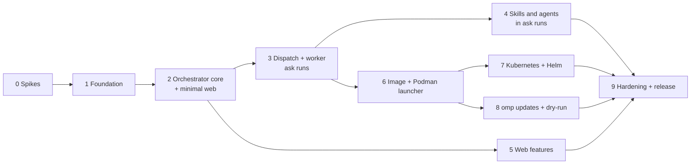

# Implementation plan

How to build AskBot as specified in [requirements.md](requirements.md) and [architecture.md](architecture.md). The plan settles the risky unknowns first, and every phase ends with something that runs.

## 1. Approach

- **Port, don't rewrite.** AgentBot (`../AgentBot`, commit `1830870`) already implements almost everything AskBot keeps: the Discord bot and `/ask`, dispatch and the run protocol, workers, the agent host and its scratch tools, the launcher, the vault, the web pages, omp updates and the Helm chart. Modules are copied as listed in §2, with their tests, and what AskBot drops is deleted. Working code is not rewritten. New code is written only where AskBot differs: `/stop` (DSC-39), skill URIs in the scratch tools (AGT-30), the task agent allowlist (AGT-25, AGT-31, AGT-32), the update panel on the web (WEB-33), the reduced settings and database, and the ask-only dry-run (OPS-06).
- **Vertical slices.** Each phase ends with a smoke run of the real thing, not only unit tests. Phase 3 runs `/ask` end to end on a real worker.
- **Traceability.** Each phase lists the requirement IDs it delivers. A phase is done when those requirements are met and its Exit has run (§5).
- **Decisions before code.** Spikes A1 and A2 (§3) settle how skills and task agents work in a restricted session before phase 4 needs them.

## 2. Repository layout

```
package.json  bun.lock  tsconfig.json  Dockerfile  .dockerignore  compose.yaml
src/
  cli.ts                  askbot orchestrator|web|worker|launcher|health
  shared/                 config schema, protocol types, log, version and app identity, http/ws client helpers
  orchestrator/
    engine/               controller, ask chat, chat slots, prompts
    discord/              bot, access, commands, progress, render, replies, topMessage, outbound queue
    dispatch/             runs table, leases, worker WebSocket, relay, outbox, artifacts, scale endpoint
    api/                  admin API, run artifact API, health endpoints
    omp/                  update checks, runtime copies
    store/                db, vault, sessions, scratch, omp assets, sign-ins, stats, agent log
  web/                    server, pages, admin API client
  worker/                 supervisor, artifacts, session and output upload, cleanup
    host/                 agent host: host, serve, session, scratchTools, oom, reap, loadout, usage
  launcher/               rootless Podman client, spawn loop, reaper
deploy/
  helm/askbot/
scripts/                  init-secrets.sh, omp-latest.ts, dry-run.ts
test/
  unit/  integration/  e2e/  fixtures/
```

One package and one image (architecture A-7). Compared with AgentBot, `src/orchestrator/github/`, `src/orchestrator/git/`, the config workspace and the VS Code extension are gone.

**Port map.** Copy from AgentBot at commit `1830870`, renaming identifiers as in architecture §10:
- `src/cli.ts`, `src/launcher/*`
- `src/orchestrator/api/{admin,channels,features,health,http,logs,models,omp,server,settingsSave,skills}.ts`
- `src/orchestrator/discord/{access,bot,commands,discordjs,interactionRouter,interactions,permissions,progress,queue,render,replies,rest,surface,topMessage}.ts`
- `src/orchestrator/dispatch/{artifacts,dispatcher,fake,leases,relay,spec,workers}.ts`
- `src/orchestrator/engine/{chatSlots,chat,controller,deps,prompts}.ts`
- `src/orchestrator/main.ts`, `src/orchestrator/omp/*`
- `src/orchestrator/store/{accounts,agentlog,db,ompAssets,runUi,scratch,sessions,signins,stats,vault}.ts`
- `src/shared/*` except `adminRepos.ts`, `adminWorkspace.ts`, `git.ts` and `workspaceSync.ts`
- `src/web/*` except `reposPage.ts`, `vscode.ts` and `workspace/`
- `src/worker/*` except `checkout.ts`; `src/worker/host/*` except `tools.ts` (`create_issue`) and `todos.ts` (`update_todos`). In `session.ts`, remove `TODO_TOOL` and `createTodoTool` from `PROFILE_TOOLS` and `customTools`, and remove the `onTodos` option.
- `scripts/{init-secrets.sh,omp-latest.ts,dry-run.ts}`
- `deploy/helm/agentbot` → `deploy/helm/askbot`
- `compose.yaml`, `Dockerfile`, `.dockerignore`, `.github/workflows/ci.yml`

Delete (do not copy):
- `src/orchestrator/api/{repos,workspace}.ts`
- `src/orchestrator/discord/{ompUpdate,questions}.ts` (the update notice moves to the web, WEB-33)
- `src/orchestrator/dispatch/checkouts.ts`
- `src/orchestrator/engine/{ciGate,draft,issues,jobs,plans,repoChat,scheduler,state,watches}.ts`
- `src/orchestrator/git/*`, `src/orchestrator/github/*`
- `vscode/`, `scripts/build-vsix.ts`, `scripts/vsix/`
- the `octokit` dependency

After the deletions, a copied module that nothing imports any more is deleted too. Tests are copied with their modules; tests of deleted modules are not copied.

## 3. Phase 0: spikes

Each spike answers one question with a throwaway prototype and a short note in `wiki/spikes/` (`A1.md`, `A2.md`). A spike that fails switches to its fallback, and the requirement is changed before phase 4 starts.

AgentBot's spikes S1 (token refresh through the orchestrator, `../AgentBot/wiki/spikes/S1.md`), S2 (agent host in a separate container, `S2.md`), S5 (KEDA `ScaledJob`, `S5.md`) and S6 (rootless Podman launcher, `S6.md`) still hold, because AskBot keeps that code unchanged. AgentBot spikes S3 (git over the internal API) and S4 (code-server lock-down) do not apply.

| # | Question | Method | Pass when | Fallback |
|---|---|---|---|---|
| A1 | Can a restricted `ask` session list and load skills through the confined `read_file` (AGT-30)? | Add the `readsSkillUris` declaration to `read_file`, and `skill://` resolution via `resolveInside` (AgentBot `src/worker/host/scratchTools.ts`). omp's gate is in `pi-coding-agent/src/session/agent-session.ts`, around L10721 (`toolReadsSkillUris`); tools declare it as `read.ts` does at L977. Run a session with one skill. | The system prompt lists the skill, and the agent reads `skill://<name>`. | The host appends the skill catalog (name, description, `skill://` path) to the prompt itself. `read_file` still serves `skill://`. Update AGT-30. |
| A2 | Can `task` in a restricted session spawn only admin agents, with only their frontmatter tools (`web_search`), with no bundled agents, and with usage counted (AGT-31, AGT-32)? | A session with `task`, one admin agent with `tools: web_search` and one with `tools: bash`. Check the spawnable list, the child's tools (`pi-coding-agent/src/task/executor.ts` ~L4092, `structured-subagent.ts` ~L586–652) and the usage totals. Try pinning `task.disabledAgents` to omp's bundled agent names. | Only admin agents spawn; the child has no tool outside its frontmatter allowlist; the parent's usage includes the child's. | Replace omp's `task` with a host custom tool `run_agent {agent, prompt}`. It creates a nested restricted session with the agent's prompt, model and allowlisted tools, inside the same limits. Update AGT-08, AGT-31 and AGT-32 to name it. |

## 4. Phases



Phase 5 can run alongside phases 3 and 4 once phase 2 is done.

### Phase 1: Foundation

**Goal:** an empty but real project with the shared pieces the components build on.

Work:
- Scaffold: `package.json` (name `askbot`, bin `askbot`; Bun, TypeScript strict, `discord.js`, `zod`, `@oh-my-pi/pi-coding-agent` pinned; no `octokit`), `tsconfig.json`, `src/cli.ts` with the role switch, and `ASKBOT_*` env loading (`src/shared/env.ts`, requirements §9).
- CI workflow (`.github/workflows/ci.yml`): typecheck and tests now; the image and Helm steps follow in phases 6 and 7.
- Shared code: logging and the rolling log (`src/shared/log.ts`, `rollinglog.ts`), version and app identity (`src/shared/version.ts`, architecture §7.1).
- The settings schema reduced to requirements §9 (`src/shared/config.ts`): `discord.askChannelIds` without the work channel and watch category, `agent.name` defaulting to `AskBot`, `models.ask`, `limits.maxChatSessions`, `limits.maxCostUsdPerTurn` and `limits.chatIdleMinutes`, `workers.*`, `logs.maxGiB`, `omp.autoUpdate`, and the two secrets.
- Database reduced to DB-01 and DB-02 (`src/orchestrator/store/db.ts`): ask chats, agent runs, runs, the relay outbox and the key-value store.
- Vault (SEC-03 to SEC-05, `src/orchestrator/store/vault.ts`).

Requirements: DB-01, DB-02, SEC-03 to SEC-05, requirements §9.

**Exit:** `bun run typecheck` and `bun test` pass. `askbot orchestrator` opens the database and serves `/livez`.

### Phase 2: Orchestrator core and minimal web

**Goal:** a configurable orchestrator that runs the Discord bot, with runs still faked.

Work:
- Controller and phases (`engine/controller.ts`, `engine/deps.ts`, `orchestrator/main.ts`), with the reduced engine start and shutdown order (ENG-01 to ENG-05).
- Health (`api/health.ts`; OBS-01, architecture §4.5, RUN-12, RUN-13) with the reduced limits block.
- Admin API skeleton (`api/server.ts`, `http.ts`, `admin.ts`, `settingsSave.ts`; SEC-14).
- Discord (`discord/*`): exactly `/ask` and `/stop` (`commands.ts`), with `/stop` replacing AgentBot's `/work cancel` in ask threads (DSC-39); access rules (DSC-01 to DSC-04, DSC-06 to DSC-08); progress (DSC-10, DSC-11, DSC-14, DSC-15); the outbound queue and steering reactions (DSC-24, DSC-32); the agent name (DSC-29 to DSC-31).
- Ask chat (`engine/chat.ts`, `engine/chatSlots.ts`) against the fake dispatcher (`dispatch/fake.ts`), which returns a canned `{answer}`.
- Minimal web (`src/web/*`): setup, login, account and sessions (WEB-01 to WEB-07, WEB-09 to WEB-11); a Settings form with typed channel ids (the dropdown comes in phase 5); web `/healthz`.

Requirements: ENG-01 to ENG-05, OBS-01, RUN-12, RUN-13, SEC-14, DSC-01 to DSC-04, DSC-06 to DSC-08, DSC-10, DSC-11, DSC-14, DSC-15, DSC-24, DSC-29 to DSC-32, DSC-39, WEB-01 to WEB-07, WEB-09 to WEB-11.

**Exit:** in a test guild, `/ask hello` posts a thread with the canned `answer.md`, and `/stop` in that thread replies "Nothing is running."

### Phase 3: Dispatch, worker and ask runs

**Goal:** real ask runs on real workers.

Work:
- Dispatch (`dispatch/{dispatcher,leases,workers,relay,artifacts,spec}.ts`): runs and leases (RUN-01 to RUN-05), the `/internal/scale` endpoint, the worker WebSocket with two-way sequencing, acks and the outbox (RUN-06), re-attach after an orchestrator restart (RUN-07, RUN-09), Discord state that survives restarts (RUN-14, `store/runUi.ts`), delivery confirmations (RUN-15) and transcript limits (RUN-16). The protocol is trimmed to architecture §4.2: the messages AskBot drops are removed, and `checkpoint` becomes `session-upload`.
- Worker (`worker/{main,runner,connection,artifacts,auth,health,status}.ts`): claim and heartbeat; downloads of the skills, the session and the scratch inputs; session uploads and the result (RUN-18, RUN-19); cleanup (RUN-20); one run per thread (RUN-21).
- Agent host (`worker/host/{host,serve,session,scratchTools,oom,reap,loadout,usage}.ts`): one `ask` profile in `PROFILE_TOOLS` (AGT-08, AGT-09), the `{answer}` schema (AGT-12), limits (AGT-14), memory handling (AGT-17 to AGT-19), omp settings and pins (AGT-20, AGT-23), loadout (AGT-27), scratch tools (AGT-28, AGT-29).
- Prompts (`engine/prompts.ts`, AGT-13, SEC-02).
- Sign-ins (`store/signins.ts`, `store/accounts.ts`; CRED-01 to CRED-03, CRED-05).
- Ask scratch transfer: inputs, outputs and the `scratch-input` message (`store/scratch.ts`; CHAT-03 to CHAT-11).
- Local development: `askbot worker` runs as a plain process against a local orchestrator. The launcher comes in phase 6.

Requirements: RUN-01 to RUN-07, RUN-09 to RUN-16, RUN-18 to RUN-21, AGT-01 to AGT-09, AGT-11 to AGT-15, AGT-17 to AGT-20, AGT-23, AGT-27 to AGT-29, CHAT-03 to CHAT-11, CRED-01 to CRED-03, CRED-05, SEC-01, SEC-02.

**Exit:** a real `/ask` with an attached PDF answers through a worker started by hand (`askbot worker`), a produced `outputs/notes.md` is attached, and the run's loadout on `/status.json` lists exactly `list_files`, `read_file`, `web_search`, `write_file` and `yield` (no agents installed). Then:
- killing the orchestrator mid-run: the run continues, re-attaches, and keeps editing the same status message;
- killing the worker: the run fails with the worker-lost message, and the next message resumes the session;
- after the run, nothing of it is left on the worker host.

### Phase 4: Skills and agents in ask runs

**Goal:** the admin's skills and task agents work in `/ask`, and nothing else can be spawned.

Work:
- Apply the A1 and A2 outcomes (§3).
- Upload validation (`store/ompAssets.ts`, `api/skills.ts`, `web/skillsPage.ts`): the AGT-25 agent frontmatter rules, refusal reasons, and broken entries in the listing.
- `skill://` in `read_file` and `list_files`, read-only, with the skill-reader declaration (`worker/host/scratchTools.ts`; AGT-30).
- `task` exposed only with a valid agent, spawning only admin agents with allowlisted tools, the worker's own agent check, and subagent usage and limits (`worker/host/session.ts`; AGT-08, AGT-31, AGT-32).

Requirements: AGT-24 to AGT-26, AGT-30 to AGT-32.

**Exit:** with skill `glossary` and agent `researcher` (`tools: web_search`) installed, an `/ask` uses both, which is visible in the loadout and the transcript. Uploading an agent with `tools: bash` is refused.

### Phase 5: Web features

**Goal:** the full admin UI. This phase can run alongside phases 3 and 4.

Work:
- Status page (`web/statusPage.ts`, `store/stats.ts`): workers, limits, the Discord queue, start-up time per run, usage by ask channel and user (OBS-05, OBS-06).
- Logs page and downloads (`web/logsPage.ts`, `web/logview.ts`, `api/logs.ts`, `store/agentlog.ts`; OBS-02 to OBS-04).
- Model sign-in (`web/modelsPage.ts`, `api/models.ts`; SEC-12, SEC-13).
- omp page with setting overrides (`web/ompPage.ts`, `web/ompForms.ts`, `api/omp.ts`; AGT-20, AGT-23). The update panel comes in phase 8.
- Ask-channel dropdown with permission checks (`web/channelFields.ts`, `api/channels.ts`, `discord/permissions.ts`, `discord/rest.ts`; WEB-20 to WEB-24).
- Home page with the reduced checklist (`web/homePage.ts`).

Requirements: WEB-20 to WEB-24, OBS-02 to OBS-06, SEC-12, SEC-13.

**Exit:** the pages are exercised in a browser against a running orchestrator: a fresh install goes from the setup token to an admin account, the Discord settings, an ask channel chosen from the dropdown and a model sign-in, with validation errors shown where they apply.

### Phase 6: Image and Podman launcher

**Goal:** the Podman stack runs the whole system, with one container per run.

Work:
- `Dockerfile`: one image, four roles, `/app/IDENTITY`, the npm-latest omp with fallback to the pin (`scripts/omp-latest.ts`); no git and no code-server.
- Launcher (`src/launcher/*`; LCH-01 to LCH-04).
- `compose.yaml` with one volume and `scripts/init-secrets.sh` (OPS-01 to OPS-03, architecture §7.2); the CI image steps (OPS-04).
- Health commands (`askbot health`), per-worker memory and scratch limits (STO-06, NFR-02), start-up time per run (NFR-06).

Requirements: OPS-01 to OPS-04, LCH-01 to LCH-04, STO-01, STO-02, STO-04, STO-06, SEC-16, NFR-01, NFR-02, NFR-06.

**Exit:** `podman compose up -d` brings up three healthy services. An `/ask` runs on a worker started by the launcher, and that worker container is removed afterwards.

### Phase 7: Kubernetes and Helm

**Goal:** the same system on Kubernetes, with 0 to 10 worker pods.

Work:
- Helm chart `deploy/helm/askbot` (architecture §7.3): orchestrator and web Deployments, Services and optional Ingress; the `ScaledJob` and `TriggerAuthentication` with the AgentBot S5 settings; the single state PVC; generated secrets; NetworkPolicies; the reduced resources and `worker.diskLimit`; the KEDA CRD check.
- CI: `helm lint`, `helm template` and the `kind` install test.

Requirements: OPS-07 to OPS-09.

**Exit:** `test/e2e/k8s/install-smoke.sh` on kind runs a real ask run.

### Phase 8: omp updates and dry-run

**Goal:** in-place omp updates approved on the web, and a local dry-run.

Work:
- In-place updates for workers (`orchestrator/omp/{updates,runtime}.ts`, `shared/ompRuntime.ts`, worker `runner.ts`): install, pack, canary and fallback, cleanup (UPD-01 to UPD-10).
- The approval endpoints `update-check`, `update-approve` and `GET /internal/admin/omp` (`api/omp.ts`), and the update panel on `/admin/omp` (`web/ompPage.ts`; WEB-33), replacing AgentBot's Discord notice.
- `scripts/dry-run.ts` rewritten for the `ask` profile (OPS-06).

Requirements: UPD-01 to UPD-10, WEB-33, OPS-06.

**Exit:** **Approve update** on `/admin/omp` installs a newer omp, which the next run reports in `run-info`. `bun run dry-run --prompt "2+2?"` prints the answer JSON.

### Phase 9: Hardening and release

**Goal:** a release that holds up against public users.

Work:
- Reliability across restarts and failures (NFR-03 to NFR-05).
- The SEC-15 NetworkPolicies and Podman network isolation, checked on kind and Podman.
- A security review of the `ask` tools (AGT-09, AGT-28 to AGT-30) and the subagent allowlist (AGT-25, AGT-31), against architecture §6.
- Memory measurement for NFR-01, replacing the estimates.
- README: install for Podman and Kubernetes, configuration, upgrade.

Requirements: NFR-03 to NFR-05, SEC-15, and every requirement re-verified.

**Exit:** the full suite and the e2e tests pass, the README is written, and the first image is published.

## 5. Verification

A phase is done when its requirement IDs are met and its Exit has run.

| Level | What | Where |
|---|---|---|
| Unit | Pure logic: settings and upload validation, path confinement and `skill://` resolution, protocol sequencing, rendering, limits. | `test/unit`, run in CI on every push. |
| Integration | Orchestrator, worker and web together against the fake Discord surface, with the fixture agent host; the outbox and reattach logic; the omp update install. | `test/integration`, run in CI. |
| End to end | Real Discord test guild and a model sign-in, on Podman and on `kind`. | `test/e2e`, run before every release. Needs the secrets of a test guild and a model account. |
| Security | The `ask` tools and the subagent allowlist, against architecture §6. | Phase 9, and before every release. |

AgentBot's tests are copied with their modules. Tests that pinned AgentBot-only wording or behaviour AskBot drops are deleted, not adapted. New permanent tests cover the boundaries AskBot adds: `skill://` escapes, refused agent uploads, the spawnable agent list, and `/stop` permissions.

## 6. Risks

| Risk | Effect | Mitigation |
|---|---|---|
| Spike A1 or A2 fails | Skills or task agents can't use omp's own mechanism in a restricted session | The fallbacks in §3: the host-built skill catalog, and the `run_agent` custom tool. |
| Prompt injection by public users through skills or agents | A public user steers the agent or a subagent toward the worker token or other files | The confined tools (AGT-09, AGT-28, AGT-30) and the `web_search`-only subagent allowlist (AGT-25, AGT-31); the phase 9 security review. |
| Cost abuse by public users | Model spend grows without an admin noticing | `limits.maxCostUsdPerTurn` per turn, one live run per public user (DSC-06), `limits.maxChatSessions`, and usage by user on the status page (OBS-06). |

## 7. Status (2026-11-02)

Every phase's work is done. Without a Discord test guild, the exits that need Discord ran against the fake Discord surface (`test/fakes/discord.ts`) in front of the real orchestrator; everything else is real.

| Phase | Exit as run | Evidence |
|---|---|---|
| 0 | Both spikes pass; no fallback | [spikes/A1.md](spikes/A1.md), [spikes/A2.md](spikes/A2.md); their conditions are in AGT-20, AGT-24, AGT-25, AGT-31, AGT-32 |
| 1 | `bun run typecheck`, `bun test`; `askbot orchestrator` opens the database and serves `/livez` | full suite (530 tests); local orchestrator run |
| 2 | `/ask hello` posts the canned `answer.md`; `/stop` replies "Nothing is running." | `test/integration/phase2.test.ts` (fake Discord) |
| 3 | `/ask` with a PDF on a worker started by hand and a real model: `answer.md` and `outputs/notes.md` attached, loadout exactly `list_files`, `read_file`, `web_search`, `write_file`, `yield`; orchestrator killed mid-run re-attaches and keeps editing the same status message; a killed worker fails the turn as lost and the next message resumes; nothing left on the worker host | a throwaway real-model run (fake Discord); `test/integration/phase3.test.ts` (fixture host). Found and fixed: elapsed time after a restart, a duplicate status edit, a lost first turn not resuming, and run directories left by a SIGKILLed worker |
| 4 | Skill `glossary` and agent `researcher` used in one `/ask` (loadout and transcript); `tools: bash` refused on upload | the same real-model run; `bun run dry-run --omp-dir`; `test/integration/agents.test.ts`; `ASKBOT_REAL_MODEL=1 bun test test/integration/realmodel.test.ts` |
| 5 | Fresh install in a browser: setup token, admin, Discord settings with validation errors, ask channel from the dropdown (hidden channel disabled, missing permission named), model sign-in, checklist complete | headless Chromium against the real web and admin API with a fake Discord REST API and sign-in; `test/integration/phase5.test.ts` |
| 6 | `podman compose up -d`: three healthy services; an `/ask` on a launcher-started worker container, removed afterwards; rootful socket refused | `test/e2e/compose/smoke.sh` (scenario orchestrator image with the fake Discord, fixture host) |
| 7 | Chart on kind with KEDA: an `/ask` on a KEDA worker Job pod, removed after the TTL; NetworkPolicies; upgrade keeps the secrets | `test/e2e/k8s/install-smoke.sh` |
| 8 | omp 18.15.0 installed into a runtime copy, packed, unpacked, and the agent host from the copy registered (canary); approval and auto-update logic; `bun run dry-run --prompt "2+2?"` prints the answer JSON | `test/e2e/omp-update/real-install.ts`; `test/integration/ompUpdate.test.ts`, `omp.test.ts`; dry-run |
| 9 | Chaos (one seed: 7 crashes across all services, every thread one answer, no duplicates, nothing left) and the limits round; security review with fixes; NFR-01 measured; README | `test/e2e/chaos/run.ts`; [security-review.md](security-review.md); NFR-01; `README.md` |

Not run: a real Discord guild (every Discord behaviour rests on the fakes) and the first image publish, which happens when CI runs on `main`.
